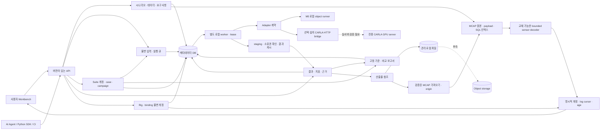

# AD E2E Platform 아키텍처

작성 기준: 2026-09-12. 이 문서는 **초기 로컬 개발판(M0)의 구현 범위와 이후 상용화 설계**를 구분한다. 기능 구현·실행 검증의 실제 상태는 저장소 README와 테스트 결과를 함께 확인한다. 설계 항목, 등록된 외부 엔진, 화면의 시각 효과를 구현 완료나 검증 완료로 해석하지 않는다.

로컬 구현 갱신: **2026-09-13**. MCAP 등록·탐색, durable execution queue, suite/campaign·보존된 비교 근거와 SQLite schema 6의 sensor rig/binding·표준 센서 payload replay·run-recording lineage·고정 모델 개정/프레임별 인지 추론·예측 비교를 반영한다. 별도 worker 프로세스는 구현했으며, 실제 센서 정확도·취득 clock/calibration 검증, PostgreSQL·분산 실행·조직 격리와 전체 상용화 gate는 후속 범위다.

목표는 요구사항에서 실차 데이터·시나리오·시험 실행·결과·검증 근거까지 이어지는 개발 플랫폼이다. Applied Intuition 공개 제품군은 기능 범위를 정리하는 참고 자료다. 내부 구현을 복제하거나 제품 간 동등 성능을 주장하는 기준으로 사용하지 않는다. [Applied Intuition 제품 소개](https://www.appliedintuition.com/products)

## 1. 먼저 해결할 문제

상용 수준의 E2E 플랫폼은 여러 시뮬레이터를 화면에 나열하는 것만으로 완성되지 않는다. 동일한 조건의 시험을 다시 실행할 수 있고, 실패가 생긴 시점과 원인을 찾을 수 있으며, 어떤 요구사항과 모델 범위에 해당하는 근거인지 설명할 수 있어야 한다.

첫 구현은 다음 업무를 끝까지 연결한다.

`시나리오 선택/작성 → 조건 변경 → 로컬 실행 → 객체 궤적 재생 → 지표 확인 → 요구사항 및 데이터와 결과 연결 → API로 반복`

**현재의 중요한 제한:** M0의 객체 모델은 플랫폼 개발과 회귀 확인을 위한 단순 모델이다. 차량·센서·인지 모델의 실측 정합성이나 실제 도로 안전을 검증하는 제품이 아니다. 브라우저의 카메라 시점과 화려한 3D 표현도 센서 시뮬레이션 출력이 아니다.

## 2. 구현 범위와 후속 범위

아래 로컬 개발판 열은 현재 구현 범위다. 오른쪽 열은 별도 구현과 검증이 필요한 제안이다.

| 영역 | 현재 로컬 개발판 범위 | 후속 설계 |
| --- | --- | --- |
| Workbench | React·TypeScript·Vite UI, 객체 궤적, 실행·지표·데이터, rig authoring과 같은 log cursor의 센서 preview·age 조사 | 실측 clock 오차가 반영된 동기 조사, 센서·지도 비교 재생, 공유 가능한 조사 화면 |
| Scenario | 자체 JSON 모델, 예제 시나리오, 파라미터 편집, revision 이력과 실행 입력 snapshot | 논리/구체 시나리오, sweep, OpenSCENARIO 변환·검증 |
| Simulation | 로컬에서 재현 가능한 toy object-level runner; 선택 설치하는 실험적 CARLA remote bridge | CARLA 실서버 검증과 perception 연결 우선, 이후 esmini·SUMO·고객 엔진 |
| Execution | SQLite durable queue, 별도 worker, lease·게시 fencing, 취소 요청·확인, 불확실 외부 엔진 격리 | PostgreSQL 큐, 분산 소유권, 명시적 retry/attempt 정책, GPU scheduling |
| Validation | case별 시나리오/판정 기준 고정, suite revision, campaign 전체 분모, baseline·조건별 비교·봉인 근거 | 독립 observer version/교체, 통계 평가, 구성요소 의존성의 변경 영향, 조직별 근거 승인 |
| Data | 관리 산출물·MCAP·정확한 ns/전체 메시지 탐색, 지원 ROS2/Foxglove sensor decoder, rig/binding revision, run artifact lineage | 실제 clock/calibration 검증, 추가 schema, object storage, 공간 인덱스, 보존 정책 |
| Agent | FastAPI OpenAPI, API 사용 설명과 Python SDK | 권한 범위가 있는 agent 도구, 계획·실행 추적, 예산 및 취소 제어 |
| Persistence | SQLAlchemy와 SQLite, schema 1/2/3/4→5 additive migration, 한 로컬 작업공간 | PostgreSQL 이관, project/tenant isolation, 운영 backup/restore 검증 |
| Security/Operations | 로컬 개발·평가 용도 | OIDC/SSO, RBAC, 감사 기록, 비밀정보 관리, 배포·업그레이드·복구 체계 |

외부 adapter가 registry에 보이는 것은 **연결 구성과 기능 범위를 설명하는 메타데이터**다. 기본 CARLA 항목은 `not_configured`이며 실제 CARLA가 번들로 포함되지 않는다. 실험적 bridge를 설치하고 URL을 지정하면 호출 설정 상태가 된다. 별도 read-only health check와 매 실행 preflight가 실제 연결을 확인하며, health의 `ready`는 모델 검증이나 이전 실행의 정리 완료를 뜻하지 않는다. 구현·설정·서버 연결·모델 검증은 서로 다른 상태다.

## 3. 구조: 공통 업무와 엔진 실행을 분리

읽기·쓰기 API와 업무 로직은 같은 backend 패키지에 두되, 새 `/jobs` 실행은 별도 worker 프로세스가 수행한다. API와 worker는 같은 host의 SQLite DB·관리 파일·adapter 설정을 사용한다. UI는 엔진 SDK나 DB를 직접 호출하지 않는다. 엔진 계산과 artifact staging은 DB transaction 밖에서 수행하며 짧은 transaction으로 소유권과 결과 게시를 확정한다. 호환용 `/runs`도 같은 큐·claim·자원 예약 경로를 사용해 inline 실행하거나 기존 worker의 결과를 기다린다.

엔진을 바꿀 때 요구사항·시나리오 ID·결과 탐색·지표의 의미는 유지한다. 반면 엔진별 물리 모델, 지원 조건, 데이터 형식, 실행 결과가 같다고 가정하지 않는다. ASAM도 OpenSCENARIO XML을 같은 형식으로 교환하더라도 서로 다른 시뮬레이터의 결과가 같아지지는 않는다고 설명한다. [ASAM OpenSCENARIO XML](https://www.asam.net/standards/detail/openscenario-xml/)

## 4. 교체 가능한 모듈의 계약

현재 Python adapter 계약은 `SimulationAdapter.metadata() → Adapter`와 `execute(Scenario) → SimulationResult`다. 선택적인 `execute_cancellable(scenario, should_cancel)`은 협력적 취소를 지원하며 reference adapter가 이를 구현한다. 기존 `execute`만 가진 adapter는 취소 요청만 기록하고 실제 중단으로 표시하지 않는다. `ade2e.adapters` entry point로 설치된 trusted plugin을 registry에 등록한다. 입력 미지원/설정 누락은 `AdapterInputError`/`AdapterUnavailable`로 분류하며 미연결 엔진을 reference runner로 조용히 대체하지 않는다. 아래 표는 이 계약을 확장할 때의 설계 요구사항이다. prepare/collect/cleanup이 모두 별도 adapter 메서드로 구현되었다는 뜻은 아니다.

기록된 센서 payload 해석은 엔진 실행과 독립된 `SensorDecoder` 계약을 사용한다. `metadata`, `accepts(channel,schema)`, `kind_for(channel,schema)`, `decode(payload,channel,schema,max_points)`를 제공하며 `SensorDecoderRegistry.register`로 교체한다. 입력은 원본 message hash를 확인한 bytes이고 출력은 decoder/version·원본 식별자·별도 capture time과 hash가 있는 PNG/XYZ preview다. 설치된 플러그인은 신뢰하는 Python 코드이며 격리된 sandbox가 아니다. Core는 반환된 이미지의 bounded CRC·실제 decode, point 수/분모/bounds·finite 값·content hash를 다시 확인하여 잘못된 결과를 `decoded`로 게시하지 않는다.

| 계약 부분 | 필수 정보 / 동작 | 필요한 이유 |
| --- | --- | --- |
| Identity | adapter ID, adapter version, engine version, 실행 이미지 digest 또는 binary hash | 이름이 같은 엔진의 서로 다른 빌드를 구분 |
| Capabilities | 지원 input/output schema와 version, 행동·지도 요소 목록, fidelity, OS/GPU 요구사항 | 지원하지 않는 기능을 조용히 생략하지 않음 |
| Validate | 구조 검증 후 단위·좌표·trigger·센서·지도 지원 여부 검사 | 실행 전 설명 가능한 오류 반환 |
| Prepare | 입력 snapshot과 산출물 경로 준비, asset checksum 확인 | 실행 중 입력이 바뀌지 않도록 고정 |
| Execute | run ID, seed, 시간 제한, 자원 제한으로 실행 | 실행을 추적하고 실패를 격리 |
| Collect | trajectory, metric, log, sensor artifact와 manifest 반환 | 모든 엔진을 같은 조사 흐름으로 연결 |
| Cancel / Cleanup | 종료 요청에 대한 상태와 자원 회수 결과 | worker 장애·사용자 취소에 대응 |
| Errors | 잘못된 입력 / 미지원 기능 / 엔진 오류 / 시간 초과 / 자원 부족을 구분 | agent가 수정·재시도·중단을 결정 |
| Evidence | 알려진 한계, 지원 ODD, 실측 상관성 자료와 유효 범위 | 모델 결과를 과도하게 일반화하지 않음 |

권장 역할 분리는 다음과 같다.

| Adapter 역할 | 입력 → 출력 | 교체 후보 |
| --- | --- | --- |
| ScenarioAdapter | 자체 시나리오 또는 표준 문서 → 검증된 구체 시험 | OpenSCENARIO XML translator, 향후 DSL compiler |
| WorldAdapter | 지도/scene revision → 도로·정적 geometry | OpenDRIVE importer, 고객 지도 |
| TrafficAdapter | world state + step → actor state | esmini, SUMO, 학습된 행동 모델 |
| VehicleAdapter | 제어 입력 + 상태 → 다음 차량 상태 | 단순 운동학, 검증된 동역학 모델 |
| SensorAdapter | 시간에 따른 장면 + sensor model → sensor stream | CARLA, 광학/센서 모델, 고객 모델 |
| SensorDecoder (구현) | 특정 schema의 기록된 payload bytes → bounded image/point preview | Foxglove JSON·고정 ROS2 CDR1 지원, registry plugin |
| StackAdapter | 객체 또는 센서 입력 → prediction/planning/control | ROS 2, 고객 RPC, 기록된 출력 |
| MetricAdapter | 시간 정렬된 상태·신호 + 판정 기준 → 값·이벤트·판정 | versioned observer plugin |
| StorageAdapter | manifest + byte stream → artifact reference | 로컬 파일, S3 호환 object storage |
| ExecutionAdapter | execution manifest → 상태·산출물 | 로컬 프로세스, 컨테이너 worker, HIL 장비 |

처음부터 이 역할을 모두 서비스로 분리할 필요는 없다. 한 엔진이 여러 역할을 제공할 수 있지만, 어떤 역할을 실제로 수행하는지는 manifest에 명시한다. 라이선스 검토도 프로세스 경계만으로 해결되었다고 판단하지 않는다.

## 5. 시나리오·시간·좌표·충실도

자체 scenario JSON은 플랫폼의 편집·실행 모델이며 ASAM 준수 인증을 의미하지 않는다. 표준 변환은 format version별 지원 목록, schema validator, 변환 보고서, 원본 artifact를 함께 보관해야 한다. OpenSCENARIO XML과 DSL은 별도 표준으로 구분한다. [ASAM XML](https://www.asam.net/standards/detail/openscenario-xml/), [ASAM DSL](https://www.asam.net/standards/detail/openscenario-dsl/)

M1 데이터 계약은 SI 단위를 사용하고 좌표 프레임과 회전 규약을 명시한다. 예를 들어 world는 지역 ENU, vehicle은 전방/좌측/상방의 오른손 좌표계를 기준으로 선택할 수 있다. 이미 있는 엔진 규약을 변환할 때 축·부호·원점·투영·고도·각도 단위를 모두 시험한다. browser의 렌더 좌표를 측정 좌표로 그대로 내보내지 않는다.

시간 계약은 simulation time, 수집 장비의 원시 timestamp, UTC 추정값, clock domain, 변환 불확도를 구분한다. worker의 처리시간은 시뮬레이션 시간과 별도다. deterministic step의 seed 고정은 GPU·OS·스레드·엔진 버전을 가로지르는 bitwise reproducibility를 자동으로 보장하지 않는다. adapter마다 `동일 빌드 재현`, `허용오차 내 재현`, `통계적 재현` 가운데 검증된 수준을 기록한다.

현재 recording bundle은 `aligned_time = log_time + 선언된 offset`으로 최신 관측 하나를 선택한다. 커서 이전 관측이 없으면 missing이며 미래 payload를 대체하지 않는다. age 정책이 없으면 unknown, 허용 age를 넘으면 stale로 표시하고 preview를 보류한다. `binding_revision`을 생략하면 저장된 latest를 자동 채택하지 않고 unbound로 조사한다. MCAP log/publish time은 uint64 십진 문자열, capture time은 payload의 별도 값으로 유지한다. 이 기능만으로 실제 장비 clock의 동기화·오차를 확인했다고 주장하지 않는다.

Rig의 convention·sensor→rig quaternion/translation·intrinsics는 출처가 있는 선언이다. 수학적 유효성과 적용 frame/kind를 검사하고 unknown/mismatch/변환 후 float32 overflow이면 rig view를 막는다. Decoder 자체는 rig transform을 적용하지 않는다. Foxglove PointCloud의 message pose만 해당 message frame으로 반영하여 `source_pose`와 `transform_policy`를 남긴다. LiDAR의 frame 이름만 보고 축 방향이나 handedness를 추정하지 않는다.

| Fidelity 표기 | 허용되는 해석 | 별도 검증이 필요한 부분 |
| --- | --- | --- |
| Toy object-level | UI·API·데이터 흐름과 단순 행동 예제 확인 | 실차 성능, 센서·인지·타이어 동역학 |
| Object closed-loop | 명시된 객체 입력에서 연결한 스택의 반응 평가 | 우회한 센서·인지 경로 |
| Log open-loop | 기록된 입력에 대한 새 출력 비교 | 자차 경로가 달라진 뒤의 반사실 센서 입력 |
| Sensor closed-loop | 명시된 센서 모델과 장면 범위 내 전체 스택 평가 | 실측 상관성, 미모델링 현상 |
| HIL | 연결 장비·I/O·clock 조건 내 실제 하드웨어의 반응 평가 | 연결하지 않은 물리 계층과 fault 영역 |

센서 모델에서는 단순 timestamp 변화와 실제 입력 변화도 구분한다. rolling shutter, 노출 적분, LED flicker는 시간에 따라 달라지는 장면을 샘플링하여 RAW/RGB 변화가 확인될 때 지원한다고 표시한다. RGB 렌더를 RAW, 파장별 광학 모델 또는 radar ADC 수준 결과로 표시하지 않는다.

## 6. 데이터 모델과 추적 관계

로컬 관계형 DB는 시나리오·작업·실행·요구사항·산출물 metadata와 MCAP 인덱스를 다룬다. 실제 v0.1 entity에는 `Scenario`, `JobSummary/JobDetail`, `WorkerSummary`, `ExecutionResource`, `RunSummary/RunDetail`, `Metric`, `Frame`, `Event`, `Provenance`, `Artifact`, `Requirement`, `Adapter`, recording 관련 모델이 있으며 [api-contract.md](api-contract.md)에 정의한다. Schema 3은 작업·append-only 이벤트·worker·자원 예약 테이블을 추가한다. 제출 시 시나리오·유효 parameter·seed·adapter version을 고정하고, 이후 시나리오 수정이나 재시작이 저장 입력을 바꾸지 않는다. 아래는 상용 단계까지 확장할 논리 모델이며, 모든 테이블이 현재 구현되었다는 뜻은 아니다.

Schema 4는 suite revisions·campaign membership·baseline·봉인 comparison을 추가했다. Schema 5는 `sensor_rigs`/`sensor_rig_revisions`, recording binding head/revision/channel mapping과 `recording_origins`를 추가한다. Binding은 실제 recording/channel 및 rig revision foreign key를 유지하고 rig snapshot·decoder version·age/offset을 고정한다. Rig/binding의 bounded canonical manifest는 DB bytes로 보존하고 SHA·크기·identity·mapping 일치를 검사하여 exact export를 제공한다. 개정 추가가 이전 export bytes를 바꾸지 않는다. 이전 schema 1–4의 기존 테이블·payload 파일은 재작성하지 않으며 알 수 없는 schema는 쓰기 전에 거절한다.

| Entity | 핵심 데이터 | 관계 / 불변성 |
| --- | --- | --- |
| Project | 이름, 소유자, ODD, 접근 정책 | 고객/프로젝트 경계의 기준; M0는 단일 로컬 workspace |
| RequirementRevision | 식별자, 명세, acceptance rule, 유효 범위 | 판정 기준 변경 시 새 revision |
| ScenarioRevision | scenario JSON, source format, hash, 조건, 태그 | 부모 revision, 원본 log/map/asset 참조 |
| MapRevision / AssetRevision | 좌표, geometry, source/license, hash, 신뢰도 | 추정 geometry와 실측 정보를 구분 |
| ModelRevision | sensor/vehicle/stack/model weights, calibration, hash | 모델 및 실측 상관성 자료 참조 |
| Dataset / LogSegment | 원본 URI, hash, time range, channels, calibration | 원본과 파생 artifact의 lineage |
| TestSpecification | requirement revision, scenario revision, metric revision, ODD | 시험 의도·판정 조건을 실행과 분리 |
| Run / Attempt | 상태, 입력 snapshot, adapter, seed, 시간, 실행 환경 | 한 요청과 재시도 attempt를 구분 |
| MetricDefinition / Result | 단위, 계산식/version, threshold, validity, 값, 이벤트 | 누락된 값은 통과로 취급하지 않음 |
| Artifact | URI, MIME/schema, byte count, SHA-256, producer, provenance | 존재 확인 및 내용 검증을 분리 |
| EvidenceLink | requirement revision → test → run/result | 결과의 적용 범위와 검토 상태 |
| AuditEvent | actor, action, target revision, request ID, 시각 | 쓰기 주체와 agent 호출까지 추적 |

상용 재현 manifest에는 시나리오·지도·모델·지표 revision, seed, 유효 parameter, adapter/engine version, 실행 환경, source artifact hash를 기록해야 한다. 현재 Run은 시나리오 snapshot·seed·adapter version·fidelity·입력/출력 hash를 보존하며 모든 지도·센서 모델·독립 observer revision이 구현된 것은 아니다. 사용자가 현재 시나리오를 수정해도 과거 실행은 당시 snapshot을 가리켜야 한다. 단순 ID 연결만으로는 변경 후 근거의 타당성을 보존할 수 없다.

대량 센서·로그 바이트는 object storage에 저장하고 DB는 참조와 검색용 metadata를 저장한다. 현재 로컬 MCAP 경로는 원본·파생 payload 객체와 recording/channel/schema/message 관계형 인덱스를 분리한다. 시각은 uint64 값을 보존하는 20자리 검색 키와 API 십진 문자열로 관리한다. 원본 통계·인덱스를 믿고 데이터를 생략하지 않고 실제 메시지를 순회해 자체 인덱스를 생성한다. 포맷 지원과 실제 message schema 지원은 별도로 관리한다. [데이터 계약](recordings-contract.md), [MCAP 공식 저장소](https://github.com/foxglove/mcap)

현재 sensor replay는 원본 MCAP를 다시 파싱하지 않고 bounded message reader에서 관리 경로·파일 크기·message SHA를 확인한다. 원본 schema는 최대 64 KiB의 완전한 preview가 있을 때만 해당 decoder의 지원 대상으로 판단하며, 임의 schema를 실행 코드로 만들지 않는다. Preview bytes는 응답 안의 base64와 hash로 전달하고 별도 cache 파일을 만들지 않는다. 이로써 미리보기 cache의 게시·수거 수명은 아직 도입하지 않았다. `index.sha256`은 payload sidecar bytes의 digest이며 SQL timestamp/index 행의 digest가 아니다.

`POST /runs/{run_id}/recordings`는 이미 존재하는 MCAP artifact의 run·내용 hash를 검사하고 원본을 recording으로 가져온다. 후속 origin 관계가 실행 snapshot·adapter/fidelity·artifact identity를 보존한다. 해당 관계의 게시가 실패하면 재요청으로 연결을 복구할 수 있지만 origin이 없는 recording을 run-linked로 표시하지 않는다. 관련 endpoint와 SDK/CLI 예제는 [센서 계약](sensors-contract.md), [지원 포맷](sensor-format-notes.md), [SDK 안내](../sdk/python/README.md)를 따른다.

coverage는 분모가 있는 정의로 관리한다. 예: `ODD bin 30개 중 유효 시험이 있는 bin 12개`. 실행 성공률, 요구사항 연결률, 지표 통과율을 하나의 안전성 점수로 합치지 않는다. 데이터가 없거나 적용 조건 밖이면 `not evaluated` 또는 `inconclusive`로 설명한다.

현재 근거는 dispatch에 진입한 유효 작업 중 가장 큰 `submission_seq`로 선택한다. 이전 제출이 늦게 끝나도 최신 시도를 덮지 않는다. 최신 작업의 running·중단·실패·adapter 호출 후 취소는 과거 통과로 되돌아가지 않는다. queued·알려진 preflight 입력 거절·adapter 호출 전에 확인된 취소는 새 근거를 만들지 않는다. 호출 직전 취소에는 이미 기록한 dispatch intent timestamp가 남을 수 있으므로 timestamp만으로 실행 근거를 판단하지 않는다. 선택된 완료 결과도 현재 시나리오 revision·seed·parameter와 일치해야 한다. 큐 도입 이전 Run은 해당 시나리오에 유효한 job 근거가 없을 때 기존 최신 Run 규칙으로 평가한다.

## 7. API와 AI Agent

UI, SDK, agent, CI는 같은 API를 사용한다. OpenAPI는 request/response의 실행 계약이고, 설명서는 workflow·제약·오류 회복과 예제를 제공한다. 화면에만 있는 동작을 핵심 제품 기능으로 만들지 않는다.

현재 API는 `/api/v1`을 사용한다. `/scenarios`, `/jobs`, `/workers`, `/execution-resources`, `/runs`, `/recordings`, `/requirements`, `/artifacts`, `/adapters`, `/overview`로 업무를 연결하며 `/agent/tools`는 도구 설명을 제공한다. 실행 중인 `/openapi.json`, `/docs`, `/redoc`, `/llms.txt` 및 SDK 문서를 사용한다. 새 UI·SDK workflow는 `/jobs`로 202와 job ID를 받고 상태·취소·결과를 조회한다. `/runs`는 같은 실행 큐를 거치는 동기 응답 호환 경로다. **멱등성 키는 endpoint별 범위**다. 응답을 잃으면 같은 endpoint·키·본문으로 재요청해야 하며 `/jobs`에서 쓴 키를 `/runs`에 보내면 별도 실행 의도가 된다. 같은 endpoint·키에 다른 본문은 409, missing resource는 404, 잘못된 입력/미연결 adapter는 422다. [v0.1 API 계약](api-contract.md), [실행 사용법](execution-jobs.md), [jobs 계약](jobs-contract.md)

다음은 현재 계약을 유지하며 상용 API로 확장할 때의 요구사항이다.

- resource version과 schema version을 명시하고 호환성 중단을 관리한다.
- 목록 응답은 pagination과 명시적인 정렬·필터를 제공한다.
- 구현된 endpoint별 멱등성을 유지하며 향후 명시적인 retry/attempt 정책과 다른 장기 생성 작업의 계약을 정한다.
- 입력 검증은 필드 경로, 오류 코드, 수정 힌트를 제공한다. 미지원 adapter는 명확히 거절한다.
- 구현된 job ID·상태·취소·결과 접근 위에 실제 엔진이 보고하는 진행 정보와 자원 한도를 추가한다.
- agent 실행에는 호출 주체, 허용 도구, 자원 한도, 요청/응답 및 근거 참조를 남긴다.
- 시나리오 생성과 시험 결과 판정을 구분한다. agent가 제안한 조건은 저장·검증 후 동일 runner로 실행한다.
- scenario·로그·문서의 텍스트는 데이터로 취급한다. 해당 텍스트가 agent 권한이나 실행 정책을 바꾸지 못하도록 한다.

LLM chat 자체를 먼저 연결할 필요는 없다. agent가 읽을 수 있는 설명·schema·예제와 안정적인 도구 호출부터 제공하고, 이후 모델 제공사를 교체 가능한 client 경계에 둔다.

## 8. 저장소와 실행을 상용 운영으로 발전시키기

SQLite로 로컬 흐름을 검증한 후 PostgreSQL로 옮길 때는 DSN 변경만으로 완료했다고 판단하지 않는다. schema migration, 기존 데이터 이관, foreign key·transaction·JSON·timestamp 동작, 동시 수정, backup/restore를 검증한다. PostgreSQL과 GIS/검색 확장의 선택도 각각 운영·라이선스 검토 대상으로 둔다. [PostgreSQL 공식 문서](https://www.postgresql.org/docs/)

현재 로컬 queue는 claim→commit→engine call→staging→fenced publication으로 진행한다. heartbeat와 게시에는 일치하는 owner token과 만료되지 않은 lease가 필요하다. API의 lease reaper와 worker가 만료 작업을 `interrupted`·결과 불명으로 기록하며 자동 재실행하지 않는다. 대기 작업은 재시작 후 계속 처리한다. queued 취소는 즉시 끝나고, core가 adapter 호출 전에 확인한 요청도 호출 없이 취소된다. 실제 호출 후에는 adapter가 중단을 확인해야 `cancelled`가 된다. 취소를 지원하지 않는 외부 실행의 결과가 도착하면 보존하고 `cancel_not_honoured`를 기록한다.

정확히 기본 reference class인 경우를 제외한 엔진은 workspace의 adapter ID로 독점 예약한다. 외부 결과가 불명이면 `reconcile_required`로 다음 동일 adapter의 dispatch를 막는다. 이전 dispatcher 종료와 실제 엔진 정리를 운영자가 확인한 뒤 명시적 reconcile로 예약을 해제하며, 이전 작업의 불명 상태는 바꾸지 않는다. 다른 workspace가 같은 원격 서버를 쓰는 경우의 분산 소유권은 제공하지 않는다.

Run·artifact 참조·작업 결과·legacy 멱등성 매핑은 함께 commit한다. 일반 실패는 해당 transaction과 staging이 소유한 파일을 정리한다. 강제 종료에 따른 미참조 staging/파일은 남을 수 있으며, 실행 중인 attempt까지 안전하게 구별하는 orphan 자동 수거는 아직 없다. PostgreSQL queue, 분산 scheduler, 자동 retry, 호스트 장애 복구는 별도 구현·인수시험이 필요하다.

OIDC/SSO와 RBAC, project 경계, 감사 기록, 암호화·비밀정보, quota, 관측성, 의존성 취약점 대응, 복구 절차는 외부 고객 파일을 받는 단계의 출시 gate다. M0는 이 gate를 통과한 배포판으로 소개하지 않는다.

## 9. 변경 순서

1. 현재 로컬 업무 흐름을 끝까지 실행하고 데이터가 남는지 확인한다.
2. snapshot·오류·adapter 계약을 고정한다.
3. 사용자가 선택한 **CARLA 주행·인지 경로**를 먼저 실제 연결하여 자체 runner와 동일한 UI/API로 결과를 조사한다.
4. 구현된 MCAP·sensor decoder·rig/binding replay 위에 실제 로그의 clock/calibration 검증, 추가 schema와 시나리오 후보 생성을 연결한다.
5. 구현된 로컬 durable queue를 기준으로 PostgreSQL·object storage·분산 소유권과 복구 정책을 확장한다.
6. 센서·동역학·실차 상관성과 상용 운영 gate를 병행한다.

각 단계의 인수 조건은 [roadmap.md](roadmap.md), 외부 구성요소의 출처·라이선스 범위는 [open-source-register.md](open-source-register.md)에 정의한다.

## 10. CARLA를 첫 실제 엔진으로 연결

첫 외부 통합은 CARLA다. Mac의 control plane은 가벼운 HTTP adapter를 사용하고, CARLA Python client와 실제 engine은 지원되는 별도 GPU worker 환경에 둔다. 공식 CARLA README는 UE5 계열의 Ubuntu/Windows 요구사항과 engine 조건을 안내한다. **현재 Mac에서 실제 CARLA sensor 출력을 생성했다고 주장하지 않는다.** [CARLA 공식 저장소](https://github.com/carla-simulator/carla)

현재 실험적 bridge 코드의 범위는 짧은 직선 도로 `lane_follow`/`emergency_brake`, RGB PNG, LiDAR, collision event와 표준 Foxglove MCAP artifact 생성 경로다. MCAP는 각 캡처의 원래 frame·sensor timestamp와 출처를 남기고 공통 recording replay로 가져올 수 있다. 다른 category는 거절한다. 이는 ground-truth를 쓰는 참조 following controller이며 **perception inference는 아직 loop에 연결되지 않았다**. 생성 코드/fixture 계약시험과 실제 CARLA 산출물 검증, 센서→인지→planning→control E2E 검증은 각각 구분한다.

연결 gate는 다음 순서로 확인한다.

1. 전용 CARLA server, 지원 OS/GPU, engine/Python client version과 asset 조건을 고정한다.
2. remote worker health가 실제 engine 연결을 확인하는지 검증하고 상태 변경 전후 오류를 시험한다.
3. 짧은 주행을 실제 실행하여 engine frame, trajectory, RGB/LiDAR artifact, 충돌 event, hash가 연결되는지 확인한다.
4. 동기 step·sensor timestamp·좌표와 actor 정리를 확인하고 실패·취소·네트워크 단절 뒤 server 상태를 확인한다.
5. 같은 조건을 재실행하고 허용오차를 측정한다. engine 실행시간과 시뮬레이션 시간을 구분한다.
6. perception model/version과 calibration을 고정하여 실제 sensor stream에서 추론하고, 해당 출력으로 후속 주행 결정을 계산한다.
7. 정한 ODD와 실측/참조 baseline에 대해 sensor·인지·최종 행동의 오차와 유효 범위를 보고한다.

전용 server가 필요한 이유는 synchronous mode·weather·actor 생성이 같은 server의 다른 client에 영향을 줄 수 있기 때문이다. 현재 adapter는 로드된 map 이름을 확인하고 다른 map 요청을 거절하며 자동 map reload·Traffic Manager 소유·전역 actor 삭제를 수행하지 않는다. server가 없으면 bridge 계약·인코딩 시험만 완료로 기록하고 실제 엔진 검증은 미완료로 남긴다.

## Recorded-image inference (schema 6)

The model registry preserves immutable ONNX artifact identities and model
revisions independently of execution. Perception jobs use the existing durable
queue with `kind=perception`; scenario-specific columns are nullable for
nonsimulation jobs. Existing simulation endpoints remain filtered to simulation jobs.
No synthetic Scenario or Run is created to represent detector inference.

A typed worker dispatches either a simulation adapter or an inference runtime.
Perception input snapshots pin recording/message/decoder/model/runtime identity;
frame rows commit running state and each output under the same lease/owner fence.
Terminal sealing preserves failed/unattempted frames and the complete selection
denominator. Input PNG artifacts survive independently of future recording
changes. Model, exact image, tensor, profile and output hashes are distinct.

Optional native inference executes in a managed child with explicit profiles,
cooperative cancellation and bounded operation deadlines. Runtime registration
stays free of ONNX/NumPy/OpenCV native imports. Output contracts and original-pixel
bounds are checked again in the core before publishing evidence. See
[perception workflow](perception.md), [contract](perception-contract.md) and
[model provenance](perception-model-notes.md). This is offline object detection;
actual engine sensor capture and closed-loop control are separate integration
gates. Labeled evaluation is implemented as the independent next layer below.

## Independent datasets and evaluation (schema 7)

Dataset images pin exact camera message and decoded PNG identity before any
model is required. The relational dataset head, immutable revisions and image
membership preserve labels, taxonomy, split and review declarations. Full
canonical manifests are exported with byte/hash checks. Dataset revision edits
never alter earlier annotation/evaluation evidence.

Detection evaluations occupy `kind=evaluation` in the existing job queue, with
relational links to exact dataset revision and source inference-job manifests.
They retain every selected split member and explicit unavailable statuses.
Prepared input derives class mapping and matches from immutable source identity;
the core rechecks this derivation and evaluator output before fenced publication.
Incomplete coverage withholds aggregate and class AP/PR. Counts and pair
diagnostics retain their evaluated-subset scope.

The replaceable `ade2e.detection_evaluators` registry imports no native metric
library into the API. The optional pinned COCO adapter runs in an owned child
using the same bounded/cancellable JSON transport as ONNX. Its AP policy and
diagnostic policy are distinct and versioned. This separates reusable product
workflow and evidence from metric implementation; it does not complete an OS
sandbox, distributed evaluation, authenticated label review or real-road
validation. [Workflow](datasets.md), [contract](datasets-contract.md),
[calculation semantics](detection-evaluation-notes.md).
