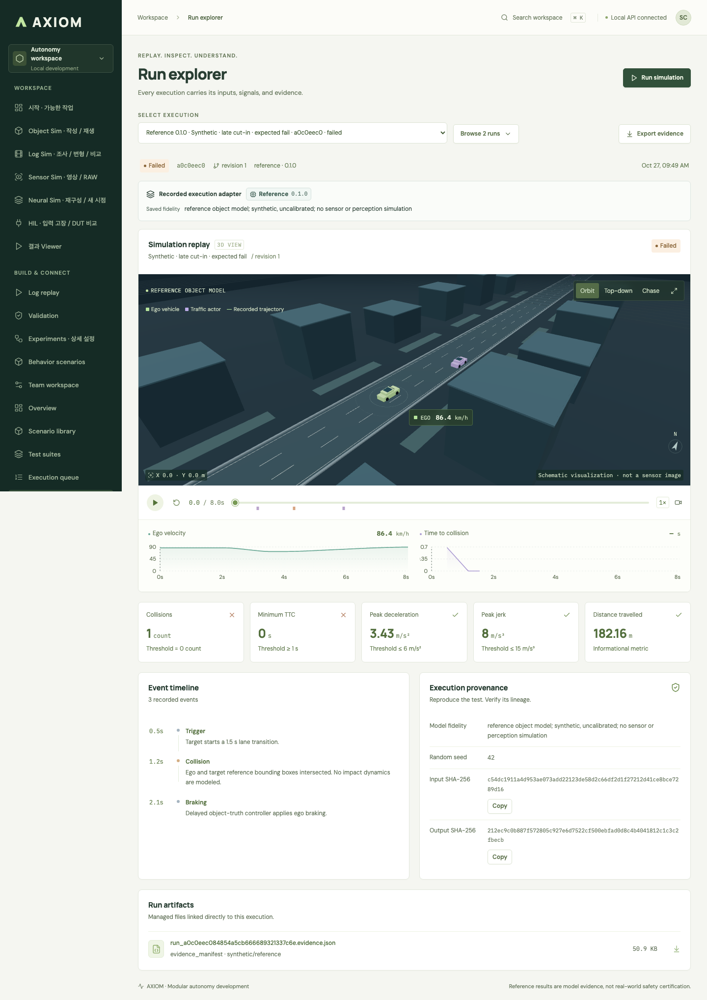
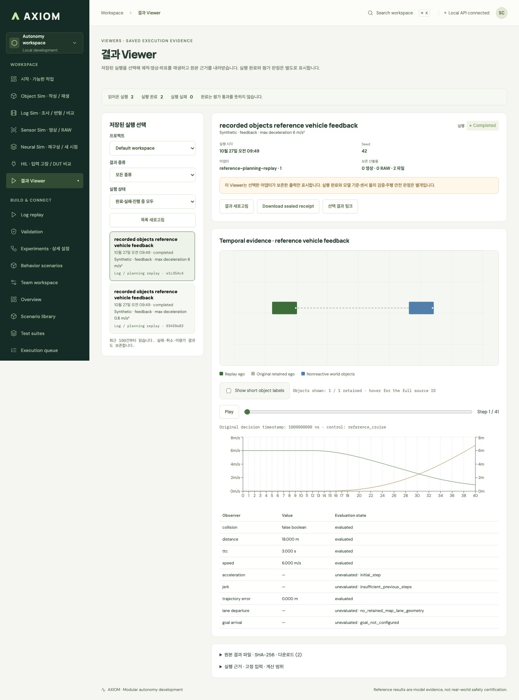

# GitHub 소스 배포 검사 · 2026-10-27

업로드용으로 선별한 별도 소스 사본에서 새 Python 가상환경과 `npm ci`를 사용했다.
운영 DB·기존 서비스·CARLA 서버에 연결하지 않았다. CPython 3.12.14,
macOS arm64, Node 25.7.0, Vite 7.3.7에서 아래 결과를 확인했다.
GitHub Actions에는 Ubuntu/Python 3.12/Node 22의 동일 샘플 검사를 설정했다.

| 확인 | 결과 |
| --- | --- |
| `bash scripts/setup_core.sh` | 새로운 환경에 core + SDK + frontend 설치 완료 |
| backend·SDK·샘플 pytest | **57 passed** |
| SQLite 3개 integrity/foreign key + 상대 경로 복사 | 통과 |
| API 결과 조회·원본 다운로드 SHA-256 | 통과 |
| Chromium 정상 화면 | **3 passed**: 세 DB, 총 6개 저장 결과의 재생·내보내기·새로고침 |
| frontend TypeScript + production build | 통과 |
| npm audit | frontend·e2e 각각 발견 0건 |
| 샘플 빌드 재실행 | 같은 입력의 참조 trace bytes 일치, 새 실행 ID·시각은 별도 |

최소 설치에서 드러난 `numpy` 필수 의존성 누락을 backend 선언에 보완했다.
Vite는 7.3.6에서 7.3.7로 고정 lock을 갱신했다.
[공식 수정 안내](https://github.com/vitejs/vite/security/advisories/GHSA-rq7h-c2jc-7f22).
기존 작업공간의 실행 중 서비스와 설치된 node_modules는 교체하지 않았다.

Python 테스트에는 Starlette/httpx·AnyIO 사용 종료 예정 경고 2개,
frontend build에는 큰 bundle 경고가 남는다. 검사 실패는 아니지만 후속 개선 항목이다.
이 검사는 모든 선택 integration이나 상용 배포의 인수를 뜻하지 않는다.
CARLA·Neural GPU·실물 HIL·센서/차량 물리 검증은 이번 작업에서 새로 실행하지 않았다.

## 포함된 예제

운영 자료를 정제한 복사본이 아니라 프로젝트가 새로 작성한 합성 입력을 실제 CPU 참조
구현으로 계산했다. SQLite와 연결된 산출물 29개 파일은 약 **6.34 MB**이며,
설명·manifest·미리보기는 별도다. [예제 명령·수치·실행 링크](../examples/github-demo/README.md).

Object DB에는 통과와 실패 각 1건을 함께 보존했다. Log open loop는 기록된 자차 궤적을
유지하며 제어 요청만 계산한다. Log feedback은 제동 상한 0.8/6 m/s² 두 조건의
실제 참조 궤적 차이를 보존한다. 차선/목표 입력이 없는 관찰자는 미평가로 남긴다.
이 판정을 실차 안전이나 센서 정확도로 해석하지 않는다.

아래는 배포 샘플을 정상 제품 화면에서 연 실제 브라우저 캡처다.

### Object: 실패 원본과 지표



### Log: open-loop 입력과 관찰값


### Log: 참조 자차 피드백



## 재검사

```sh
.venv/bin/python -m pytest scripts/tests/test_github_demo.py backend/tests/test_platform.py sdk/python/tests/test_client_protocol.py -q
npm --prefix frontend run build
npm --prefix e2e ci
cd e2e
npx playwright install chromium
npx playwright test --config github-demo.config.ts
```

브라우저 검사는 8341–8343 API, 5341–5343 UI 포트에 새 복사본을 띄우고 종료한다.
포트가 이미 사용 중이면 소유 서비스를 재사용하거나 종료하지 않고 실패한다.
진단용 복사본은 `e2e/.runtime/`, 화면과 실패 trace는 `e2e/test-results/`에 남는다.

## 업로드 경계

현재 작업 트리의 소스·필수 자산·선택 adapter 코드·notice·예제 DB를 선별했다.
원래 Git 이력과 index, 운영 DB, 토큰, 내부 서버 전용 launcher,
engine/model binary, 외부 데이터셋, 대용량 과거 validation/report는 제외했다.
과거 문서의 로컬 근거 링크가 이 배포본에서 열리지 않을 수 있다.
`PUBLICATION-MANIFEST.json`에 포함 파일 해시와 문서의 개인 경로 치환을 명시한다.
기존 개발 저장소를 정리하거나 전체 변경을 자동 commit하지 않았다.
